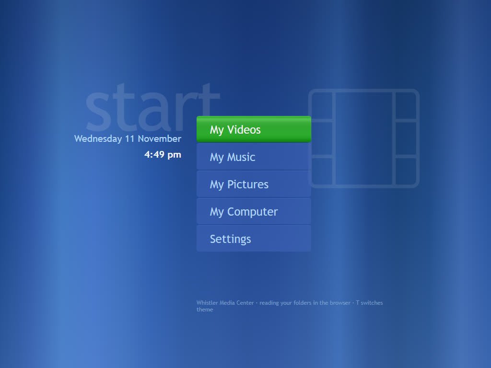
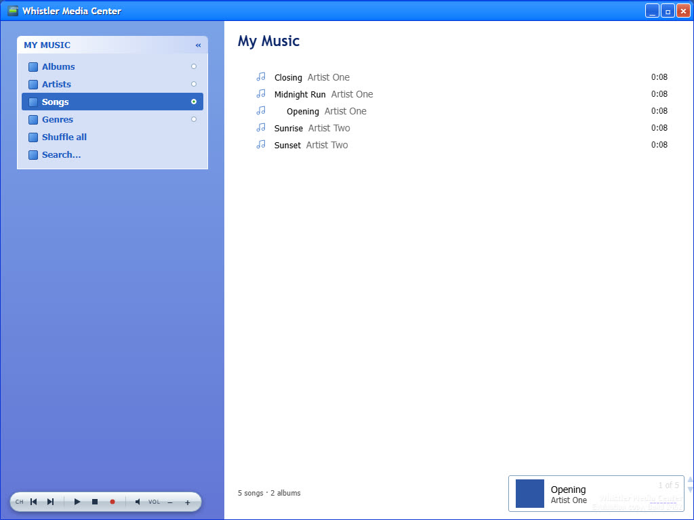
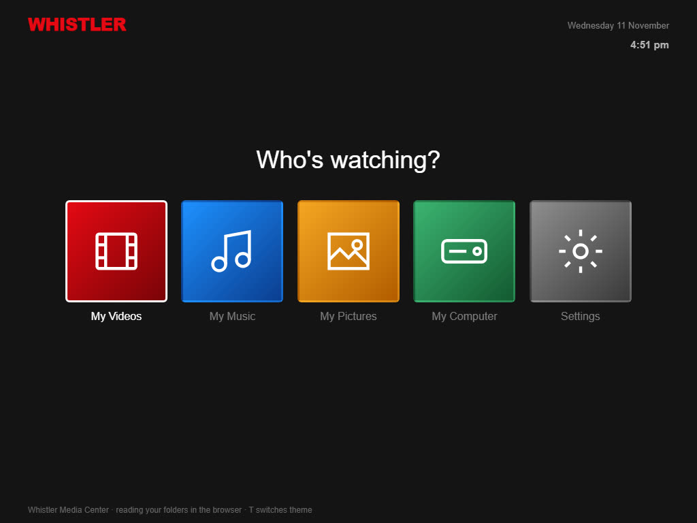
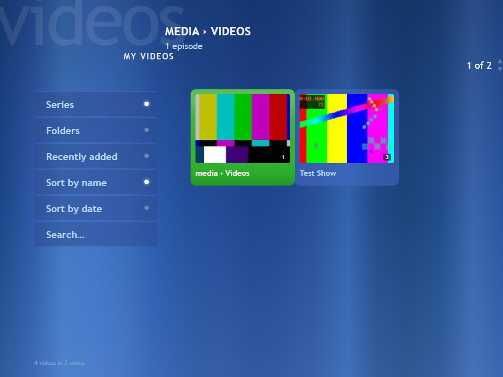
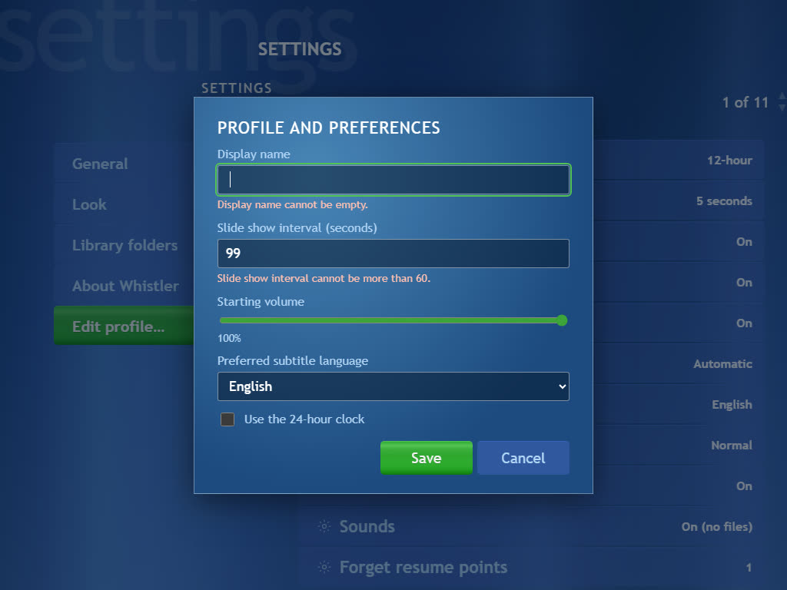
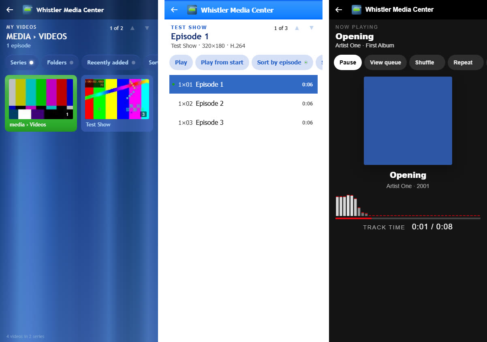

# Whistler Media Center

## Ders projesi bilgileri (OYG103 JavaScript Uygulamaları)

|                  |                                                                                                 |
| ---------------- | ----------------------------------------------------------------------------------------------- |
| Öğrenci          | Burak Hamza Öztürk                                                                              |
| Öğrenci numarası | 250184023                                                                                       |
| Okul / Program   | İstanbul Gelişim Meslek Yüksekokulu, Bilgisayar Teknolojileri Bölümü, Ön Yüz Yazılım Geliştirme |
| Ders             | OYG103 JavaScript Uygulamaları, 2. Aşama (HTML, CSS ve JavaScript yapısı)                       |
| Dil              | HTML, CSS ve saf JavaScript (çerçeve yok, derleme adımı yok)                                    |

**Amaç.** Kişisel video, müzik ve fotoğraf arşivini hiçbir program kurmadan, hiçbir sunucu
çalıştırmadan, yalnızca bir tarayıcı sekmesinde ve Windows XP Media Center Edition 2002'nin
uzaktan kumanda arayüzüyle izlemek. Sayfa, kullanıcının seçtiği klasörü File System Access API
ile doğrudan okur; bütün dosya çözümleyicileri (ID3, FLAC, MP4, Matroska altyazı çıkarma)
tarayıcının içinde çalışır.

**Çalıştırma.** `index.html` dosyasını Chrome veya Edge ile açmak yeterlidir. Bilgisayarım
ekranında "Open a folder…" ile bir klasör seçilir (ya da klasör sayfaya sürüklenir), sol sütundan
"Use as Videos / Music / Pictures folder" ile kütüphaneye eklenir.

**Anahtar özellikler**

- Kurulumsuz: klasör bir kez seçilir, tarayıcı hatırlar.
- Üç tema: Media Center 2002 (gerçek kabuğun ölçülerinden), Whistler Beta 2 (Luna 2462) ve Netflix; **T** tuşuyla geçiş.
- Videolarım: dosya adlarından dizi ve bölüm gruplama, kaldığı yerden devam, kare küçük resimleri, gömülü (MKV, SRT/ASS) ve yan altyazılar, bölüm listesi, otomatik sonraki bölüm.
- Müziğim: etiketlerden albüm / sanatçı / şarkı / tür, kapak resmi, çalma kuyruğu, karıştır, tekrar, Web Audio görselleştirici.
- Resimlerim: klasör karoları, Ken Burns efektli slayt gösterisi.
- Bilgisayarım ve Ayarlar: klasör bağlama, saat, altyazı dili, tema, ses efektleri, kaynak seçimi.
- Formlar: "Profil ve tercihler" formu (Ayarlar › Edit profile…) ve liste içinde arama formu (**/** tuşu).
- Klavye, fare, dokunmatik ekran ve oyun kumandası ile gezinme; telefon ekranında tek sütunlu düzen.
- İsteğe bağlı, sıfır bağımlılıklı Node sunucusu (`server.js`) ile ağ üzerinden izleme.

### Ekran görüntüleri

| Media Center 2002 teması                                                                                    | Whistler Beta 2 teması                                                                                                   |
| ----------------------------------------------------------------------------------------------------------- | ------------------------------------------------------------------------------------------------------------------------ |
|                 |      |
| **Netflix teması**                                                                                          | **Videolarım (2002)**                                                                                                    |
|                        |                             |
| **Profil formu ve doğrulama iletileri**                                                                     | **Telefon düzeni (üç tema)**                                                                                             |
|  |  |

### 2. Aşama kontrol listesi: hangi madde nerede?

| Madde                           | Projede karşılığı                                                                                                                                                                                                                                                                                                                                                                                                        |
| ------------------------------- | ------------------------------------------------------------------------------------------------------------------------------------------------------------------------------------------------------------------------------------------------------------------------------------------------------------------------------------------------------------------------------------------------------------------------ |
| **Semantik etiketler**          | `index.html`: sayfa iskeleti `<header id="site-header">`, `<main id="screen-host">`, `<footer id="site-footer">`; her ekran bir `<section>` ve içinde `<header>`, `<nav>`, `<footer>`; karolar `<article>`, kapak ve fotoğraflar `<figure>` / `<figcaption>`, şimdi çalan kutusu `<aside>`, saat ve süreler `<time>`. Ekran yapıları JavaScript içinde değil, `index.html` sonundaki `<template>` bloklarında yazılıdır. |
| **Form ve input yapıları**      | `index.html` içinde `#profile-form` (`type="text"`: `required`, `minlength`, `maxlength`, `placeholder`; `type="number"`: `required`, `min`, `max`, `step`; `type="range"`; `<select required>`; `type="checkbox"`) ve `#search-form` (`type="search"`). Kurallar HTML niteliklerinden okunur, ileti alanın altında gösterilir: `js/forms.js`.                                                                           |
| **Veri gösterim elemanları**    | Başlat menüsü ve komut sütunu `<ul>`; satır listeleri `<ul>`, numaralı listeler (bölümler, albüm parçaları, kuyruk) `<ol>`; tuş rehberi (`#key-legend`) ve Hakkında sayfasındaki tuş / kumanda tablosu `<table>` (`<caption>`, `<thead>`, `scope`).                                                                                                                                                                      |
| **Responsive arayüz ve medya**  | Masaüstünde 1024×768 sahne pencereye oranlı ölçeklenir; 760 pikselden dar (veya 480 pikselden kısa) ekranlarda `css/responsive.css` bütün temaları tek sütunlu, kaydırılabilir düzene çevirir. Görsellerde `alt`, `width`, `height`, `loading="lazy"`; video küçük resimleri 192×108 JPEG olarak üretilip önbelleğe alınır.                                                                                              |
| **Temiz kod ve girinti**        | Bütün HTML, CSS ve JavaScript dosyaları Prettier ile aynı kurallarla biçimlendirilmiştir (`.prettierrc.json`, `.editorconfig`: 2 boşluk girinti).                                                                                                                                                                                                                                                                        |
| **İsimlendirme**                | `class` ve `id` adlarının tamamı kebab-case: `site-header`, `mode-list`, `tile-grid`, `profile-form`, `display-name-error`. Durum sınıfları `is-` ile başlar: `is-focused`, `is-playing`.                                                                                                                                                                                                                                |
| **Dosya ve klasör hiyerarşisi** | `/index.html`, `/css/` (`style.css`, `responsive.css`, `themes/`), `/js/` (`main.js`, ortak modüller, `screens/`), `/assets/` (`images/`, `sounds/`). Ayrıntı aşağıda.                                                                                                                                                                                                                                                   |
| **Açıklama satırları**          | `index.html` içinde her bölümün ve her şablonun üstünde; CSS dosyalarında her bölümün başında; JavaScript'te her dosyanın başında ve fonksiyonların üstünde (JSDoc biçiminde).                                                                                                                                                                                                                                           |
| **ES6+ değişken yönetimi**      | `var` hiç kullanılmamıştır; yalnızca `const` ve `let`. Adlar camelCase ve anlamlıdır: `currentScreen`, `scanRoots`, `formatTime`, `subtitleChoice`. Sabitler `UPPER_SNAKE_CASE`: `DEFAULT_SETTINGS`, `SEEK_STEP_SECONDS`.                                                                                                                                                                                                |
| **Karar yapıları**              | `switch`: tuş yönetimi (`js/input.js`, `js/browse-screen.js`, `js/video-player.js`, `js/photo-viewer.js`, `js/ui.js`), görünüm seçimi (`js/screens/`). `if / else if / else`: alan doğrulama (`findFieldError`, `js/forms.js`), dosya adı çözümleme (`js/library.js`).                                                                                                                                                   |
| **Döngü yapıları**              | `for...of` (klasör tarama, gruplama), klasik `for` (spektrum çubukları, küçük resim parlaklığı, karıştırma), `while` (tarama kuyruğu, birim dönüşümü), `forEach` / `map` / `filter` (liste çizimi).                                                                                                                                                                                                                      |
| **Modüler fonksiyon tasarımı**  | Eski tek dosyalık `app.js` 18 dosyaya bölündü (`parsers.js` ve `source.js` ile toplam 20 betik); her dosya tek bir işi yapar. Ortak ekran `createBrowseScreen` beş ekranda yeniden kullanılır.                                                                                                                                                                                                                           |
| **Parametre ve return**         | Fonksiyonlar girdilerini denetler ve tutarlı tür döndürür: `formatTime` ve `formatBytes` (sayı değilse güvenli değer), `openScreen` (ekran nesnesi değilse `TypeError`), `setVolume` (0-100 arasına sıkıştırır), `parseWholeNumber` (tam sayı değilse `TypeError`), `cloneTemplate` (şablon yoksa `Error`).                                                                                                              |
| **Hata yakalama**               | `try / catch` ve kullanıcıya anlaşılır ileti: ayar kaydı (`persistState`, `js/state.js`), klasör açma (`pickFolderWithFeedback`), altyazı dosyası okuma (`pickSubtitleFile`), form değeri dönüştürme (`js/forms.js`), kayıtlı durumun okunması ve açılış (`js/main.js`), kütüphane tarama (`js/screens/`). Teknik ayrıntı `reportProblem` ile konsola yazılır.                                                           |

### Dosya yapısı

```
index.html                  sayfa: iskelet, formlar, simge seti, ekran şablonları
css/
  style.css                 temel görünüm (Media Center 2002) ve ortak bileşenler
  themes/whistler.css       Whistler Beta 2 (Luna) teması
  themes/netflix.css        Netflix teması
  responsive.css            küçük ekran düzeni
js/
  main.js                   giriş noktası: uygulamayı başlatır
  utils.js                  yardımcılar: DOM, biçimlendirme, yol, sıralama
  state.js                  ayarlar, kütüphane klasörleri, temalar
  ui.js                     bildirim, ileti kutusu, sesler, ses düzeyi, tam ekran
  forms.js                  form doğrulama ve değer dönüştürme
  navigation.js             sahne ve ekran yığını
  input.js                  klavye, oyun kumandası, sürükle-bırak
  library.js                klasör tarama, dosya adı çözümleme, küçük resimler
  browse-screen.js          ortak gözatma ekranı (karolar / satırlar)
  music-player.js           müzik çalar, kuyruk, şimdi çalan şeridi
  video-player.js           video oynatıcı, altyazılar, bölümler
  photo-viewer.js           fotoğraf görüntüleyici ve slayt gösterisi
  source.js                 medya kaynağı: tarayıcı klasörleri veya sunucu
  parsers.js                ID3 / FLAC / MP4 / Matroska okuyucuları
  screens/                  start, videos, music, pictures, computer, settings
assets/
  images/icon.svg           uygulama simgesi
  images/screenshots/       bu sayfadaki ekran görüntüleri
  sounds/                   isteğe bağlı gezinme sesleri (README.txt)
server.js                   isteğe bağlı Node sunucusu (sayfa onsuz da çalışır)
```

---

Windows XP Media Center Edition 2002 in a browser tab, reading your own folders. Nothing to
install, nothing running in the background: open the page, point it at a folder once, watch.

It is the third member of a small family. **Neptune Media Center** is the PSP one, **Kiyora**
is the Windows one, and this is the web one. Neptune and Odyssey were Microsoft's codenames
for the consumer and business Windows that never shipped; they were merged into **Whistler**,
which became XP, and XP's Media Center Edition is the default look here. The naming, in
other words, is load-bearing.

## Run it

Open `index.html` in **Chrome or Edge**, or host the folder anywhere static (GitHub Pages, a
NAS, a USB stick). First visit: My Computer, _Open a folder…_, pick your anime folder, choose
_Use as Videos folder_. The browser remembers the folder between sessions and asks for a
one-key nod before reading it again.

Every parser (ID3, FLAC, MP4, Matroska subtitles) runs in the page. How the page gets at the
folder depends on the browser:

| Browser         | Opening folders                                                         | Between sessions                                                                                                         |
| --------------- | ----------------------------------------------------------------------- | ------------------------------------------------------------------------------------------------------------------------ |
| Chrome, Edge    | _Open a folder…_ (File System Access API), or drop a folder on the page | Remembered; one keypress to reconnect                                                                                    |
| Firefox, Safari | _Open a folder…_ (a folder picker), or drop a folder on the page        | Forgotten by the browser; the page asks you to pick the same folder again, and your library and resume points carry over |

Playback is whatever the browser decodes. Tested here on Firefox 156: H.264 and AV1 in MKV
play, MP4 plays, HEVC does not. Chromium plays HEVC when the HEVC Video Extension is installed.

There is also an **optional** `server.js` (Node, zero dependencies) for two cases: watching
from another device on the LAN, and browsers without folder access. `node server.js --open`
or `start.cmd`. Same page, same code; Settings › Look › Source switches between the two.

## Three themes

Settings › Look, or press **T** anywhere.

| Theme             | What it is                                                                                                                                                                                                                                                                                                         |
| ----------------- | ------------------------------------------------------------------------------------------------------------------------------------------------------------------------------------------------------------------------------------------------------------------------------------------------------------------ |
| Media Center 2002 | The original. Measured from the real shell's resource DLL (build 5.1.2600.1106): its palette, Trebuchet, 239x55 start entries, 251x51 buttons, 212x196 tiles, the 150px watermark at 12.5%, the translucent blue slabs and the soft green focus gloss, and the painted light-curtain backdrop rebuilt as gradients |
| Whistler Beta 2   | Luna as it stood in build 2462: blue title bar, Explorer task pane on the left, white content, Tahoma, Bliss behind the window, and the "Evaluation copy" stamp on the desktop                                                                                                                                     |
| Netflix           | Black and red, "Who's watching?" on the start screen, a hero that shows whatever you have focused, rows of 16:9 cards                                                                                                                                                                                              |

The 2002 and Whistler themes lay out on a fixed 1024x768 canvas scaled to the window,
because the proportions are the design. Netflix goes fluid. On a phone, or in a window
narrower than 760px, every theme becomes one scrolling column with an app bar and a back
button; the colours stay with the theme.

## What's in it

| Start menu  | What it does                                                                                                                                                                  |
| ----------- | ----------------------------------------------------------------------------------------------------------------------------------------------------------------------------- |
| My Videos   | Groups scene-release names into series, episode lists with resume marks, frame thumbnails, embedded and sidecar subtitles, chapters, hold-to-scan, autoplay next              |
| My Music    | Albums / Artists / Songs / Genres from real tags, embedded or folder cover art, now-playing with a Web Audio spectrum, queue, shuffle, repeat, keeps playing while you browse |
| My Pictures | Folder tiles as 2x2 contact sheets, slide show with Ken Burns drift                                                                                                           |
| My Computer | The folders you opened (or, in server mode, every drive). Any media file plays from here; any folder can be made a library folder from its left column                        |
| Settings    | Clock, slide show, subtitles, theme, library folders, source, and the profile form                                                                                            |

My TV and Play DVD are omitted rather than faked, same reasoning as Kiyora.

**Search.** Press **/** on any list (or choose _Search…_ in My Videos, My Music and My
Pictures) and type part of a title, an artist or a file name. Backspace clears the search.

**Profile and preferences.** Settings › _Edit profile…_ opens a form for the display name
(shown in the Whistler theme's start menu), the slide show interval, the starting volume, the
preferred subtitle language and the clock format. Each field says what is wrong with it
before anything is saved.

## The video player

Press **Up** (or click OPTIONS) for the options menu:

| Option                                                                                                    | What it does                                                                                                                                                              |
| --------------------------------------------------------------------------------------------------------- | ------------------------------------------------------------------------------------------------------------------------------------------------------------------------- |
| Subtitles                                                                                                 | Every subtitle track embedded in the MKV (SRT and ASS), plus a sidecar `.srt`/`.vtt`. Listed by language and name, so "Full Subtitles" and "Signs & Songs" are told apart |
| Audio                                                                                                     | Lists the audio tracks. A browser cannot switch between them; the file's default plays                                                                                    |
| Chapters                                                                                                  | The MKV's chapter list to jump to. `,` and `.` step through them, or skip 90 s without chapters                                                                           |
| Speed, Picture (fit/fill), Subtitle size, Full screen, Restart, Next episode, Mark as watched, Key legend |                                                                                                                                                                           |

Other keys: Enter pauses, Left/Right tap seeks 10 s and holding scans at 2/4/8x, N/P skip
episodes, S toggles subtitles, + and − (or the wheel) change volume, M mutes, F full screen,
H shows the key legend. Gamepads work: A opens, B goes back, Y opens options, X toggles
subtitles. With a mouse or a finger: CC, OPTIONS and STOP sit on the picture.

A subtitle track is picked automatically from the preferred language in Settings, preferring
"Full" or "Dialogue" tracks over signs, then a sidecar, then anything.

**Embedded subtitles without ffmpeg:** the page walks the Matroska file cluster by cluster and
pulls out only the blocks of the chosen track, converting ASS dialogue to WebVTT. Blocks that
the muxer zlib-compressed (mkvmerge does this to text tracks; Crunchyroll-sourced releases
are full of it) are inflated with the browser's built-in DecompressionStream. The ASS style
table is read too, so top-aligned and italic styles come through. Positioned typesetting and
sign/song styles are dropped. The result is cached in the browser so the second time is instant.

**A file with no subtitle track** (a dubbed movie, say): Subtitles › _Open a subtitle file…_
takes an .srt, .vtt, .ass or .ssa from anywhere on disk, in UTF-8, UTF-16 or Windows-1254.
A file with the same name next to the video is picked up automatically.

Partially synced cloud files read as zeros past a point; the walker resyncs to the next
cluster and returns what it can.

## How the code is laid out

The file tree is in the Turkish section above. Three things worth knowing:

- **The structure is in the HTML.** `index.html` holds the page skeleton, both forms, the icon
  sprite and a `<template>` for every screen. The scripts clone a template and fill in the text;
  they do not build markup out of strings.
- **Classic scripts, one global scope.** The page has to work when `index.html` is opened
  straight from disk, and browsers refuse ES modules over `file://`. So the scripts are loaded
  in dependency order by plain `<script>` tags, and `js/main.js`, the last one, starts the app.
- **Cascade layers.** `css/style.css` is the `base` layer, the themes are the `themes` layer
  and `css/responsive.css` is the `responsive` layer. A later layer always wins, so a theme can
  restyle the base, and the phone layout can rearrange any theme, without selector-weight fights.

`data/` appears in server mode only: library folders, resume points, tag cache.

## What plays

Whatever your browser decodes. Chromium and Edge handle **H.264** and **AV1**, and **HEVC**
when the HEVC Video Extension is installed. 10-bit HEVC depends on the GPU; older codecs in
AVI generally do not play. The player says so instead of showing a black screen.

## Sounds

The shell had four: a tick on every cursor move, a note on select, a buzz on error and a
startup sting. Whistler plays them if `assets/sounds/focus.wav`, `select.wav`, `error.wav`
and `intro.wav` exist, with an on/off row in Settings. None are bundled; the originals are
Microsoft's. Put your own there, or leave the folder empty.
